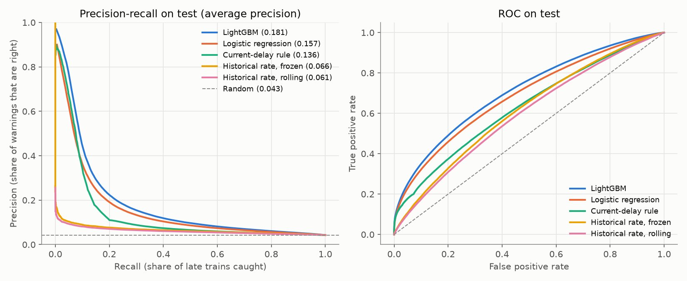
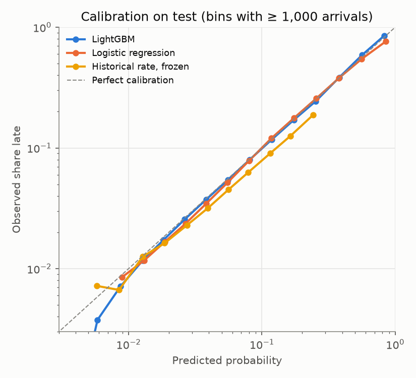
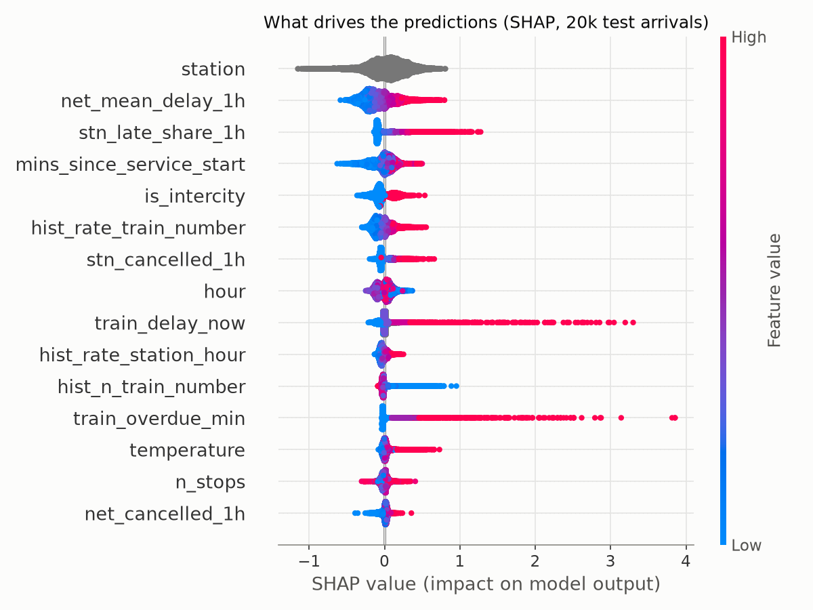
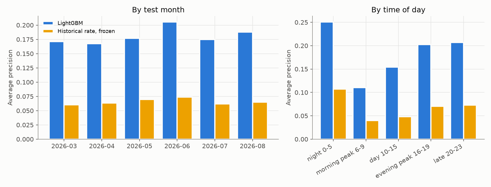

# Predicting Dutch train delays one hour ahead

Will an NS train arrive at its station 5+ minutes late? This project predicts it **one hour before the scheduled arrival**, using only information available at that moment, for 24 million arrivals of Intercity and Sprinter trains (Sep 2024 – Aug 2026).

On six months of unseen test data, a LightGBM model reaches an **average precision of 0.181** (95% CI 0.172–0.191), **2.8× a historical-rate baseline** (0.066) and clearly above logistic regression (0.157). The base rate is 0.043.



**What makes this project interesting**

- **Strictly leakage-free.** Every feature is built "as of" one hour before arrival, and an automated test proves it: changing everything that happens after a cutoff must not change any feature computed before it.
- **The hard part is real.** At prediction time, 71% of trains haven't departed yet, and they account for about 60% of all late arrivals. The model has to infer delays from the state of the network, not just read off the train's current delay.
- **A new feature that measurably helps.** "Overdue" detects trains that should have passed a stop before T0 but haven't. Removing it costs more average precision than any hyperparameter choice.
- **Honest evaluation.** Time-based split, baselines, a test set scored once, day-level bootstrap confidence intervals, calibration, and error analysis by segment.

---

## Problem

- **Unit:** one scheduled arrival of an NS Intercity or Sprinter train at a Dutch station (cancelled arrivals excluded).
- **Label:** arrival delay ≥ 5 minutes.
- **Prediction moment (T0):** scheduled arrival minus 60 minutes.

**Why 5 minutes:** at 1–3 minutes, 10–31% of arrivals would count as late, mostly noise for a traveller. At 10 minutes only 1.6% are, too few to learn from well. At 5 minutes it's 5%, still 1.2M positive examples.

## Data

| Source | Content | Licence |
|---|---|---|
| [Rijden de Treinen, train archive](https://www.rijdendetreinen.nl/en/open-data/train-archive) | Every passenger train with planned times, delays and cancellations per stop; 25 monthly files | CC BY 4.0 |
| [Rijden de Treinen, stations](https://www.rijdendetreinen.nl/en/open-data/stations) | Station codes, countries, coordinates | CC0 |
| [KNMI hourly weather](https://www.daggegevens.knmi.nl/klimatologie/uurgegevens) | Wind, gusts, temperature, precipitation, visibility, snow, thunder at ~50 stations | CC BY 4.0 |

After filtering to NS Intercity and Sprinter: 29.1M stop records over 2.74M journeys. Each station is linked to the nearest of 30 weather stations that measure temperature, rain and gusts reliably (14 km away on average).

**Data issues found during exploration** ([notebook](notebooks/01_eda.ipynb)):
- Cancelled arrivals (6.5%) are stored with a delay of 0. Without removing them they'd look like on-time trains.
- A few journeys show delays of exactly ~24 hours: the planned time is a day off. Journeys with delays ≥ 600 minutes are removed.
- KNMI's monthly exports overlap by one day, which a row-count check caught. They're deduplicated.
- The late rate is seasonal: ~7–8% in autumn, ~4% in spring and summer.

## Method

### Leakage rules
Every feature only uses what was known at T0. All times are stored in UTC, so "one hour before" is always 60 minutes, even across clock changes.

| Feature group | Examples | Why it's known at T0 |
|---|---|---|
| Schedule | station, hour, weekday, train type, minutes since the trip started | timetable |
| Train state | delay at the last stop actually passed, worst delay so far, **minutes overdue** | only events that happened ≥ 1 minute before T0 |
| Network, last hour | arrivals, late share, mean delay and cancellations, nationwide and at the station | counted over [T0 − 60 min, T0) |
| History, 28 days | late rate of the network, station, station × hour, train number (smoothed) | days D−29 to D−2; the 2-day lag covers arrivals just after midnight, whose T0 falls on an unfinished day |
| Weather | temperature, wind, gusts, rain (1 h and 3 h), strongest gust in NL | weather hours that ended ≥ 1 hour before T0 |

The feature build over 23.7M rows uses DuckDB, with ASOF joins ("latest event before T0") and running totals for the time windows. It takes a few minutes on a laptop.

`tests/test_leakage.py` builds features on a synthetic network, randomly changes all delays and weather after a cutoff, rebuilds, and checks that every feature for arrivals with T0 before the cutoff is identical, at three cutoffs. Planting a leak in train state, weather, network window or history makes it fail and name the column.

### Split
By scheduled arrival date, never shuffled:

| Split | Period | Arrivals | Late |
|---|---|---|---|
| Train | Sep 2024 – Nov 2025 | 14,750,724 | 5.30% |
| Validation | Dec 2025 – Feb 2026 | 2,872,152 | 5.31% |
| Test | Mar 2026 – Aug 2026 | 6,061,916 | 4.26% |

All choices (hyperparameters, early stopping, the alarm threshold) were made on validation. The final model was refit on train + validation, as decided in advance, and the test set was scored once.

### Models
1. **Historical rate, frozen:** late share per station × hour over the training months.
2. **Historical rate, rolling:** the same over the last 28 days.
3. **Current-delay rule:** rank by the train's known delay at T0 (current or overdue).
4. **Logistic regression:** all features, missing values filled per feature, station / hour / weekday one-hot.
5. **LightGBM:** all features, station as a categorical, small search over tree complexity, early stopping on validation.

## Results

Test set, March–August 2026. 95% intervals from a bootstrap over days (500 resamples):

| Model | Average precision | 95% CI | ROC-AUC | Brier |
|---|---|---|---|---|
| Historical rate, frozen | 0.066 | 0.063–0.069 | 0.613 | 0.0406 |
| Historical rate, rolling | 0.061 | 0.059–0.064 | 0.595 | 0.0407 |
| Current-delay rule | 0.136 | 0.129–0.143 | 0.631 | – |
| Logistic regression | 0.157 | 0.148–0.166 | 0.687 | 0.0386 |
| **LightGBM** | **0.181** | **0.172–0.191** | **0.710** | **0.0379** |

Average precision is the main metric because only 4.3% of arrivals are late: always predicting "on time" is 96% accurate and useless. The paired bootstrap gives LightGBM − logistic regression = **+0.025 (95% CI +0.023 to +0.026)**.

**Ablation (validation):**

| Model | Average precision |
|---|---|
| Full model | 0.241 |
| Without the overdue feature | 0.232 |
| Without station | 0.234 |

The four hyperparameter settings tried all scored within 0.240–0.241, so the gains come from features, not tuning.

**As an alarm.** Flagging the riskiest 4.9% of arrivals (share chosen on validation) gives 19.9% precision (4.7× chance) and catches 22.7% of late arrivals.

**Calibration.** Predicted probabilities match observed rates from 1% up to ~85%. The frozen historical rate over-predicts, because the test period is calmer than training.



**What drives predictions (SHAP).** The state of the network and the station in the last hour, the station itself, how far into its trip the train is, train type and the train number's history. The train's own delay and overdue minutes have the largest individual effects, but only for the minority of trains that are already running.



Station is shown in grey because it has no meaningful order; its effect is shown per station in [`figures/shap_station.png`](figures/shap_station.png).

### Where it works and where it doesn't
Full tables in [`results/error_analysis.md`](results/error_analysis.md).

| Segment | Average precision |
|---|---|
| Train already running at T0 | 0.291 |
| Train not running yet at T0 | 0.104 |
| Train overdue at T0 | 0.645 (85% of late ones caught) |
| Morning peak (6–9h) | 0.110 |
| Evening (16–23h) | 0.20–0.21 |
| Intercity / Sprinter | 0.262 / 0.112 |
| Per test month | 0.168–0.206 |

- **Hardest: trains not yet running, the morning peak, Sprinters, and small delays.** Recall is 19% for 5–9 minute delays vs 36% for 20+ minutes. These are mostly disruptions that start after T0.
- **Stable over time:** no drop across the six test months.



## Limitations
- Disruptions that begin after T0 (equipment failures, accidents) can't be predicted from these features. That explains most of the remaining error.
- Weather is observed before T0, not forecast. A production system would use forecasts for the arrival time.
- The test period is spring and summer, so storm and snow conditions are barely tested.
- Cancelled stops are skipped when computing "overdue". In rare cases a cancellation may only be decided after T0.
- Which trainset runs which trip (rolling stock circulation) isn't in the data.

## How to run
Python 3.11+. On macOS also `brew install libomp` (for LightGBM). Needs ~2 GB of disk; tested on a 16 GB MacBook.

```bash
pip install -r requirements.txt
make all     # download → build → features → train → evaluate
make test    # leakage tests (~5 s)
```

| Step | Command | Time |
|---|---|---|
| Download (~890 MB) | `make download` | a few minutes |
| Clean to Parquet | `make build` | ~1–2 min |
| Features (23.7M rows) | `make features` | a few minutes |
| Baselines + LightGBM | `make train` | ~15 min |
| Figures, CIs, error analysis | `make evaluate` | ~5–10 min |

## Repository
```
src/
  config.py          paths, dates, horizon, delay threshold
  download.py        raw data download
  build_dataset.py   raw CSVs → Parquet (stops, weather, station → weather station)
  features.py        feature engineering in DuckDB, everything as of T0
  train.py           baselines, logistic regression, LightGBM, one-time test evaluation
  evaluate.py        curves, calibration, SHAP, bootstrap CIs, error analysis
notebooks/01_eda.ipynb   exploration that motivates the choices above
tests/test_leakage.py    automated leakage test
results/   metrics.json, evaluation.json, error_analysis.md, shap_importance.csv
figures/   plots used in this README
```

Train data by Rijden de Treinen (rijdendetreinen.nl). Weather data by KNMI.